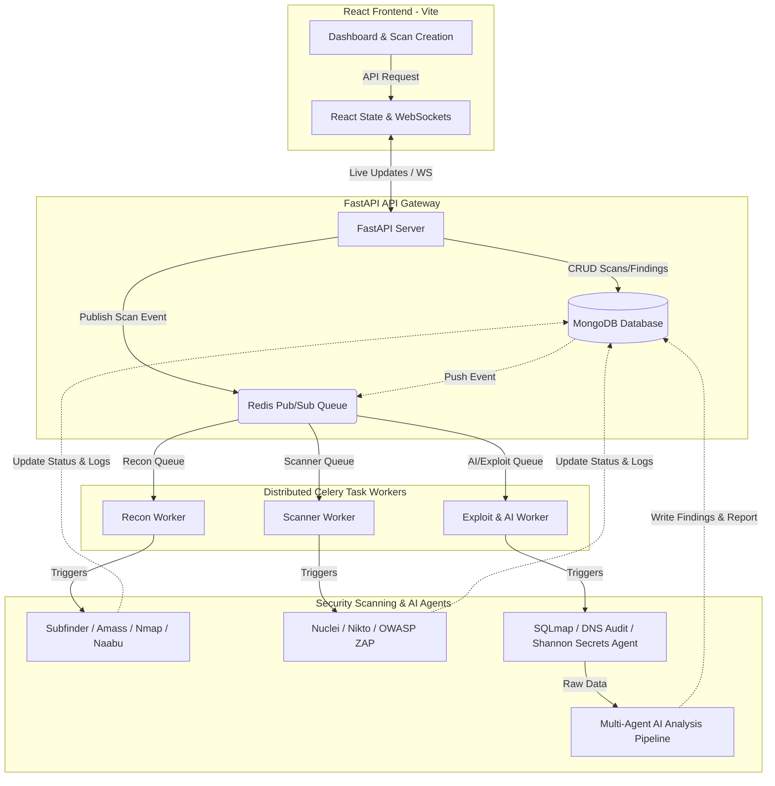

# 🛡️ ArgoLock — AI-Powered VAPT Platform Documentation

ArgoLock is a premium, state-of-the-art **Vulnerability Assessment and Penetration Testing (VAPT)** platform. It automates industry-standard security scanners, performs active validation probing, calculates risk metrics, and uses multi-agent AI pipelines to generate secure remediation advice and professional audit reports.

---

## 💡 1. Ideology & Core Philosophy

In modern software engineering, development speed is scaling exponentially. Teams using tools like Claude Code, Cursor, and Copilot ship updates multiple times a day. However, traditional security audits and penetration tests remain manual, expensive, and occur monthly or annually. This creates a massive window of vulnerability exposure.

ArgoLock was created to bridge this gap. Its core ideology is built on three pillars:

1. **Continuous & Automated Proving**: Traditional SAST/DAST tools generate large volumes of speculative warnings (false positives) that overwhelm security teams. ArgoLock believes in **proof-by-exploitation**. If a vulnerability cannot be actively probed or validated with a working Proof of Concept (PoC), it is triaged or separated from high-confidence exploits.
2. **AI-Orchestrated Expertise**: Security scanners are great at finding patterns, but terrible at understanding business context, chain-exploitation potential, and writing remediation code. ArgoLock integrates specialized AI agents to act as the parser, CVSS auditor, secure-code generator, and report compiler.
3. **Resilient Local Execution**: Security testing tools are notorious for friction in setup. ArgoLock is built with an **intelligent fallback architecture**. If a target binary (like Nmap or Naabu) is missing from the environment, the system automatically swaps it for a native Python socket/network implementation to ensure the pipeline never fails.

---

## 🏗️ 2. System Architecture

ArgoLock is split into a modular, decoupled microservices architecture. It uses asynchronous task queues for execution scaling and a WebSockets interface to stream live tool output back to the client.

### Architectural Workflow



### Component Details
*   **FastAPI API Server**: Serves as the central API gateway. Handles authorization, user sessions, scope validations, scan creation, database CRUD, and WebSockets connections.
*   **Celery Workers**: Distributed Python task queues executing long-running reconnaissance, active scanning, exploitation, and AI analysis steps.
*   **Redis Pub/Sub**: Manages the message broker for Celery queues and handles live scan logs/progress broadcasting to WebSocket clients.
*   **MongoDB**: Stored document history for scans, parsed findings, raw tool logs, system reports, and user collections.
*   **OWASP ZAP Orchestrator**: Containerized daemon exposing API commands to run deep active/passive HTTP spider checks.

---

## 📂 3. Codebase File Structure

ArgoLock separates client-side presentation from backend security processing:

### 3.1 Backend File Structure (`/backend`)
```
backend/
├── agents/                      # AI Agent definitions and logic
│   ├── __init__.py
│   ├── base_agent.py            # Base wrapper for LLM interaction
│   ├── vulnerability_agent.py   # Parser & OWASP-category mapper
│   ├── risk_scoring_agent.py    # CVSS calculator
│   ├── remediation_agent.py     # Secure code & fix advisor
│   ├── report_agent.py          # Executive summary compiler
│   └── shannon_agent.py         # Exposed secrets detection agent
├── ai_providers/                # AI LLM Provider wrappers
│   ├── __init__.py
│   ├── base_provider.py
│   ├── openai_provider.py       # OpenAI GPT models support
│   ├── claude_provider.py       # Anthropic Claude models support
│   └── ollama_provider.py       # Local Ollama models support
├── app/                         # FastAPI core application files
│   ├── __init__.py
│   ├── config.py                # Environment settings parser
│   ├── database.py              # MongoDB connection and indexes config
│   ├── main.py                  # API application root & WS server
│   ├── models/                  # Pydantic data schemas & models
│   │   ├── finding.py
│   │   ├── report.py
│   │   ├── scan.py
│   │   └── user.py
│   ├── routers/                 # API endpoint routers
│   │   ├── auth.py              # User signup, login & OTP auth
│   │   ├── findings.py          # Findings query
│   │   ├── health.py            # API health checker
│   │   ├── reports.py           # HTML / PDF generator endpoints
│   │   ├── scans.py             # Launch / Cancel scans endpoints
│   │   └── system.py            # Agent, tool configuration & history clear
│   ├── services/                # Backend utilities and validators
│   │   ├── scope_validator.py   # Domain, IP validation rules
│   │   └── websocket_manager.py # WebSocket connections registry
│   └── utils/
│       ├── crypto.py            # Argon2 password hashing helper
│       ├── otp.py               # TOTP verification codes helper
│       └── purge_db.py          # Database purger script
├── prompts/                     # System instruction prompts for AI Agents
├── reports/                     # Report generation logic
│   ├── pdf_generator.py         # WeasyPrint engine mapping
│   └── templates/
│       └── report.html          # Professional HTML template for PDF layout
├── tests/                       # Unit and integration test suite
│   ├── conftest.py              # Test database and loops fixtures
│   ├── test_auth.py
│   ├── test_exploitation.py     # Shannon and Exploitation tests
│   ├── test_new_tools.py
│   └── test_tools.py
├── tools/                       # Integrations for command-line scanners
│   ├── base_tool.py             # Subprocess execution and parsing wrapper
│   ├── nmap_tool.py             # Nmap wrapper with Python socket fallback
│   ├── naabu_tool.py            # Naabu wrapper with Python port fallback
│   ├── subfinder_tool.py
│   ├── amass_tool.py
│   ├── httpx_probe_tool.py      # HTTP technological probe wrapper
│   ├── whatweb_tool.py
│   ├── nuclei_tool.py           # Nuclei JSON parser wrapper
│   ├── nikto_tool.py            # Nikto wrapper with socket scanner fallback
│   └── sqlmap_tool.py           # SQLmap exploit safe automation wrapper
├── workers/                     # Celery queue worker functions
│   ├── celery_app.py            # Celery app initialization
│   ├── recon_worker.py          # Runs active/passive reconnaissance
│   ├── scanner_worker.py        # Runs vulnerability scanners
│   └── exploit_worker.py        # Runs exploitation, secrets, & AI pipeline
├── requirements.txt             # Python backend dependencies
└── start.sh                     # Launch script for Docker environments
```

### 3.2 Frontend File Structure (`/frontend`)
```
frontend/
├── src/
│   ├── assets/                  # Icons, image files
│   ├── components/              # Premium reusable UI components
│   │   ├── Sidebar.tsx          # Navigation controls sidebar
│   │   ├── ScanForm.tsx         # Launch Scan configuration form
│   │   ├── ScanProgress.tsx     # Pipeline stage progress tracker
│   │   ├── LogStream.tsx        # WebSocket real-time log terminal
│   │   ├── FindingsTable.tsx    # Interactive findings tables
│   │   ├── SeverityBadge.tsx    # Severity indicators
│   │   └── OTPModal.tsx         # Two-factor login popup
│   ├── lib/                     # API client utilities
│   │   ├── api.ts               # Production HTTP API Client
│   │   └── websocket.ts         # WebSocket connection manager
│   ├── pages/                   # Application page views
│   │   ├── Dashboard.tsx        # Vulnerability trends dashboard
│   │   ├── ScansPage.tsx        # Scan history list view
│   │   ├── ScanDetailPage.tsx   # Live scan logs & findings viewer
│   │   ├── FindingsPage.tsx     # Global vulnerabilities reviewer
│   │   ├── ReportsPage.tsx      # Security auditing report center
│   │   ├── AgentsPage.tsx       # System Agents registry dashboard
│   │   ├── ToolStatusPage.tsx   # Installed scanner binary diagnostic
│   │   ├── Login.tsx            # Premium glassmorphic authentication page
│   │   └── OAuthCallback.tsx
│   ├── App.tsx                  # Main router config
│   ├── App.css
│   ├── index.css                # Global CSS styling, tokens, gradients
│   └── main.tsx                 # Client entry point
├── vite.config.ts               # Vite configuration with proxy ports
├── tailwind.config.js           # Tailwind utility configurations
├── tsconfig.json                # TypeScript compiler parameters
└── package.json                 # Frontend dependencies
```

---

## 🛠️ 4. Security Tools & Intelligent Fallback

To minimize deployment friction, ArgoLock implements a dual-mode execution strategy: **Subprocess Execution Mode** (running binary files directly on the system) and **Docker Execution Mode** (running containerized tools). Additionally, if a required tool is completely missing, the backend triggers built-in Python fallbacks:

| Tool | Phase | Core Function | Intelligent Fallback Mechanism |
| :--- | :--- | :--- | :--- |
| **Subfinder** | Recon | Discovers active subdomains using OSINT sources. | Skips and logs warning if binary/container is absent. |
| **Amass** | Recon | Performs DNS mapping and subdomain enumeration. | Skips and logs warning if binary/container is absent. |
| **Naabu** | Recon | Fast port scanner using TCP/UDP SYN probes. | **Custom Port Scanner**: Native multi-threaded Python TCP socket connection scanner probing top target ports. |
| **Nmap** | Recon | Port scan, service version, and OS detection. | **Nmap Fallback Engine**: Multi-threaded Python service scanner identifying active socket banners. |
| **httpx-probe**| Recon | Probes HTTP/HTTPS targets for tech stack, headers. | **Custom HTTP Probe**: Native Python `httpx` scanner extracting Server headers, titles, and redirect states. |
| **WhatWeb** | Recon | Identifies Content Management Systems (CMS). | **Technology Fingerprinter**: Custom Python regex matcher parsing HTML headers, meta tags, and cookies. |
| **Nuclei** | Scanning | Fast, template-based active vulnerability scanning. | Skips if missing (requires official template definitions). |
| **Nikto** | Scanning | Scans for outdated configurations and files. | **Config Probe Fallback**: Python socket probe checking for common paths (`/phpinfo.php`, `/.env`, etc.). |
| **OWASP ZAP** | Scanning | Automated deep active web app spidering. | Skips and logs warning if the ZAP API container is offline. |
| **SQLmap** | Exploit | Safe validation of SQL injections. | Skips if missing; capped to safe params (`level=1`, `risk=1`, max 5 targets). |
| **DNS Audit** | Exploit | Assesses email spoofing and phishing exposures. | **Built-in DNS Resolver**: Python subprocess checking TXT/DMARC records (`nslookup` on Windows, `dig` on Linux). |

---

## 🤖 5. The Multi-Agent AI Pipeline

Once active tools finish executing, the raw logs and findings are passed to a highly structured, 4-stage AI Agent Pipeline that turns scanning data into developer-friendly security guides:

```
[Raw Tool Output / Scans JSON]
              │
              ▼
┌───────────────────────────┐
│ Stage 1: Vuln Agent       │ ──► Parse & Map to OWASP Top 10 categories
└─────────────┬─────────────┘
              │
              ▼
┌───────────────────────────┐
│ Stage 2: Risk Scoring     │ ──► Calculate CVSS v3.1 Metrics
└─────────────┬─────────────┘
              │
              ▼
┌───────────────────────────┐
│ Stage 3: Remediation      │ ──► GenerateSecure Fix Steps & Code Snippets
└─────────────┬─────────────┘
              │
              ▼
┌───────────────────────────┐
│ Stage 4: Report Compiler  │ ──► Write Executive Summaries & PDF layouts
└───────────────────────────┘
```

1.  **Vulnerability Agent**: Receives raw output from tools like Nuclei, Nikto, and SQLmap. It parses outputs, deduplicates identical findings across different tools, normalizes title names, and maps the issue to official **OWASP Top 10** categories.
2.  **Risk Scoring Agent**: Evaluates the severity of findings. It computes the **CVSS v3.1** vector string (e.g., `CVSS:3.1/AV:N/AC:L/PR:N/UI:N/S:U/C:H/I:H/A:H`) and generates the base score (0.0 - 10.0) based on actual impact.
3.  **Remediation Agent**: The secure coding advisor. Instead of general tips, it writes tailored step-by-step remediation procedures and code snippets in the language used by the target application (Python, JavaScript, Java, PHP, Go).
4.  **Report Agent**: Summarizes the entire penetration test. It writes an executive summary, calculates the overall Security Posture Grade (A to F), compiles metrics, and templates the technical chapters for report printing.

---

## 🔒 6. Stage 5: Shannon Secrets Audit Agent

As part of the exploitation stage, ArgoLock integrates the **Shannon Secrets Audit Agent** (`shannon_agent.py`). This agent acts as a high-fidelity scanner for exposed credentials, certificates, API tokens, and configurations.

### 6.1 Shannon Entropy Calculation
The agent calculates the mathematical **Shannon Entropy** ($H$) of strings, which measures the randomness of information in a sequence of characters:

$$H = -\sum_{i=1}^{n} p(x_i) \log_2 p(x_i)$$

Where:
*   $p(x_i)$ is the probability (frequency ratio) of the character $x_i$ appearing in the target string.
*   Randomly generated strings (like private keys or API keys) exhibit high entropy ($H \ge 4.5$), whereas plain English words or standard code files exhibit lower entropy.

### 6.2 Intelligent Secret Detection Rules
To prevent false positives (like random CSS class names or hash variables), the agent implements a **dual-threshold contextual rules engine**:
*   **Contextual Match Threshold**: If a variable or line contains explicit identifier substrings like `api_key`, `secret`, `password`, `token`, or `credential`, it triggers a finding at a lower entropy threshold ($H \ge 3.5$) and minimum length ($\ge 12$).
*   **High-Entropy Standalone Threshold**: If no contextual string matches, a finding is only raised if the string displays high randomness ($H \ge 4.5$) and is sufficiently long ($\ge 20$ characters) to indicate an active key or secret.
*   **Known Regex Signatures**: Incorporates exact regex signatures for high-impact credentials:
    *   **AWS Credentials**: `AKIA[0-9A-Z]{16}` and `(?i)aws(.{0,20})?(key|secret|token)?`
    *   **GitHub Pat Tokens**: `gh[pso]_[a-zA-Z0-9]{36,255}`
    *   **Private Keys**: `-----BEGIN [A-Z ]*PRIVATE KEY-----`
    *   **Slack Webhooks**: `https://hooks.slack.com/services/T[a-zA-Z0-9_]+/B[a-zA-Z0-9_]+/[a-zA-Z0-9_]+`

---

## 🚀 7. Setup & Multi-Port Conflict Resolution

### 7.1 Configuration Environment
Copy [backend/.env.example](file:///d:/Argolock/Argolock/Argolock/backend/.env.example) to `.env` and set up the variables:
```env
MONGODB_URL=mongodb://localhost:27017
MONGODB_DB=vaultx
REDIS_URL=redis://localhost:6379/0
AI_PROVIDER=openai
OPENAI_API_KEY=sk-proj-...
OPENAI_MODEL=gpt-4o
```

### 7.2 Multi-Port Conflict Configuration
If you have another developer application running on port `8000`, configure ArgoLock to run on port `8001`:

1.  **Backend port assignment**: Launch uvicorn specifying port `8001`:
    ```powershell
    venv\Scripts\python.exe -m uvicorn app.main:app --host 127.0.0.1 --port 8001
    ```
2.  **Frontend proxy matching**: Update [vite.config.ts](file:///d:/Argolock/Argolock/Argolock/frontend/vite.config.ts) and [websocket.ts](file:///d:/Argolock/Argolock/Argolock/frontend/src/lib/websocket.ts) to route queries to `8001`:
    ```typescript
    // In vite.config.ts:
    proxy: {
      '/api': { target: 'http://localhost:8001', changeOrigin: true },
      '/ws': { target: 'ws://localhost:8001', ws: true },
    }
    
    // In websocket.ts:
    const WS_BASE = import.meta.env.VITE_WS_URL || 'ws://localhost:8001';
    ```

### 7.3 Start Command Checklist (Windows Dev Mode)
Run each command in a separate terminal:

*   **Terminal 1 (Backend API Server)**:
    ```powershell
    cd backend
    venv\Scripts\python.exe -m uvicorn app.main:app --host 127.0.0.1 --port 8001
    ```
*   **Terminal 2 (Recon Queue Worker)**:
    ```powershell
    cd backend
    venv\Scripts\python.exe -m celery -A workers.celery_app worker -Q recon,default -n recon@%h --loglevel=info -P solo
    ```
*   **Terminal 3 (Scanner Queue Worker)**:
    ```powershell
    cd backend
    venv\Scripts\python.exe -m celery -A workers.celery_app worker -Q scanner -n scanner@%h --loglevel=info -P solo
    ```
*   **Terminal 4 (AI & Exploit Queue Worker)**:
    ```powershell
    cd backend
    venv\Scripts\python.exe -m celery -A workers.celery_app worker -Q ai,exploit -n ai@%h --loglevel=info -P solo
    ```
*   **Terminal 5 (Vite React Frontend)**:
    ```powershell
    cd frontend
    npm run dev
    ```
    *(Accessible at http://localhost:5173)*
